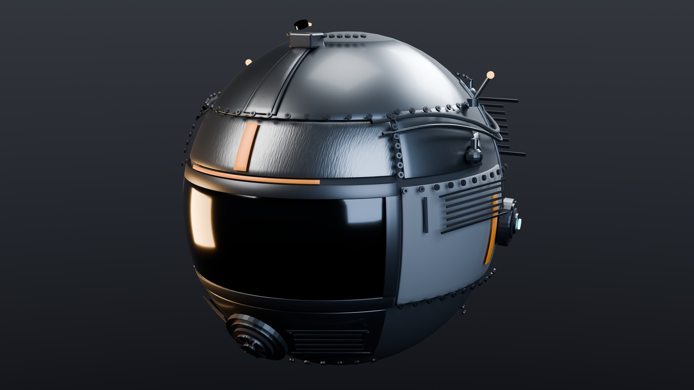

# Tactical Mech Helmet — 战术机甲头盔

一件硬表面建模练习作品。题材是科幻战术机甲头盔，从基础体块开始，用程序化曲面生成器搭出装甲分块，再补机械细节、材质、布光，最后做了一轮完整的拓扑/UV/法线质检。

这是我自己做的一个练习项目，目的很明确：把硬表面资产从建模到质检的整条链路走一遍，并且每一步都能打开源文件复核。



## 成品规格

| 项目 | 值 |
| --- | --- |
| 渲染 | Cycles，7680×4320（8K），AgX |
| 三角面 | 43,984 |
| 网格对象 | 413（按功能分组命名） |
| 铆钉 | 145 组（共享网格实例化） |
| 材质 | 10 种程序化 PBR，零外部贴图 |
| 源文件 | Blender 4.5.16 LTS `.blend` |

## 目录结构

```
.
├── tactical_mech_helmet.blend   # 源文件，含完整几何/材质/灯光/相机
├── renders/
│   ├── hero.png                 # 8K 主视觉
│   └── hero_preview.jpg         # 网页预览用压缩图
├── previews/
│   └── helmet.glb               # 实时预览模型（可选，方便在线查看）
├── evidence/
│   ├── wire.png                 # 拓扑布线检查
│   ├── normals.png              # 法线朝向检查（相机空间配色）
│   ├── uv.png                   # UV 棋盘格检查
│   └── audit.json               # 几何预检实测数据
├── docs/
│   ├── asset-spec.md            # 资产规格：目标值 vs 实测值、结构/材质清单
│   └── qa-report.md             # 质检报告：A–F 六类二元判定
├── src/blender/
│   ├── build_helmet.py          # 建模脚本（从零重建整个资产）
│   ├── render_views.py          # 渲染脚本（主视觉 + 三种质检视图）
│   └── audit_helmet.py          # 预检脚本（导出 audit.json）
└── README.md
```

## 建模思路

头盔主体不是靠布尔运算切出来的——布尔容易在切口留下乱线，后面改拓扑很痛苦。
我的做法是：把头盔看成一颗椭球，写了一个曲面装甲板生成器，按「水平角 u + 高度 v」
的参数域在椭球面上取点，每块板输出规则的四边面网格，再用 Solidify 给厚度、
Bevel 倒外缘。

这样有几个好处：

- **布线可控**。每块板都是规则网格，线框图里能直接看清走向（`evidence/wire.png`）。
- **分块天然干净**。板与板之间的缝就是分件线，不需要额外切缝。
- **可复现**。改几个参数就能调板的范围和密度，`build_helmet.py` 可以从零重建全部 417 个对象。

机械细节（铆钉、液压杆、散热格栅、呼吸器、耳部模组、天线、走线）用基础体堆，
按功能命名。铆钉用共享网格实例化，145 颗只占一份网格数据。

## 材质与布光

材质全是程序化 Principled BSDF，没有外部贴图。深枪灰钛合金主体（Metallic 0.96 /
Roughness 0.37），拉丝金属用 Noise + Mapping 把噪声在一个方向压扁再接 Bump，
磨砂陶瓷脸颊板用高 Roughness，橙色警示线给了一点微弱自发光。面罩是烟熏镜面。

布光是三点式工作室：大面积柔光箱当主光，冷色补光，背部轮廓光，另加顶光和
橙色点缀光。背景用程序化垂直渐变，没有放实体地板——之前放过，渲染出来能看到
地台边缘，去掉之后背景就干净了。

## 质检做法

质检报告（`docs/qa-report.md`）用二元判定：通过 / 不通过 / 需人工复核，
每条「通过」都必须有实测值或截图撑着，不写「看起来没问题」。

流程是两段交叉验证：

1. 先跑 `audit_helmet.py` 量能从文件里直接读出的数值——非流形边、游离点线、UV 覆盖、
   变换是否应用、反转面等，导出 `evidence/audit.json`。
2. 再看取证截图判断脚本量不到的部分——棋盘格是否真均匀、法线配色是否连续、
   金属质感是否可区分、有没有穿帮。

报告里如实记了三处「需人工复核」：662 个 N-gon（来自倒角/固化的过渡面）、
UV 未做 0–1 图集排布（本项目用程序化材质不需要烘焙）、377 个未应用旋转
（都是铆钉五金件的安装朝向）。这些是已知取舍，写清楚来源和后续处理路径，不做掩盖。

## 复现方法

需要 Blender 4.5 或更高版本。

```bash
# 从零重建资产（会覆盖 .blend）
blender -b --factory-startup --python src/blender/build_helmet.py -- --out .

# 重新渲染主视觉
blender -b tactical_mech_helmet.blend --python src/blender/render_views.py \
  -- --mode hero --out renders --res 7680x4320 --samples 64

# 重新渲染质检取证图
for m in wire normals uv; do
  blender -b tactical_mech_helmet.blend --python src/blender/render_views.py \
    -- --mode $m --out evidence --res 1920x1080 --samples 32
done

# 重新导出几何预检数据
blender -b tactical_mech_helmet.blend --python src/blender/audit_helmet.py -- --out evidence
```

渲染脚本只读场景，不会改写 `.blend`。取证视图会临时切换材质，同样不保存。

## 参考与许可

本题材为原创设计。造型语言来自通用工业与科幻道具设计常识，未复制任何具体作品、
角色或商业 IP。全部几何、材质、灯光由本地 Blender 制作，未使用第三方模型、贴图
或 HDRI，因此不存在需要额外授权的素材。
